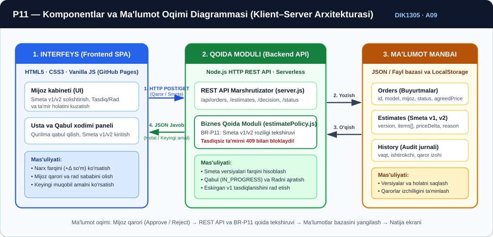
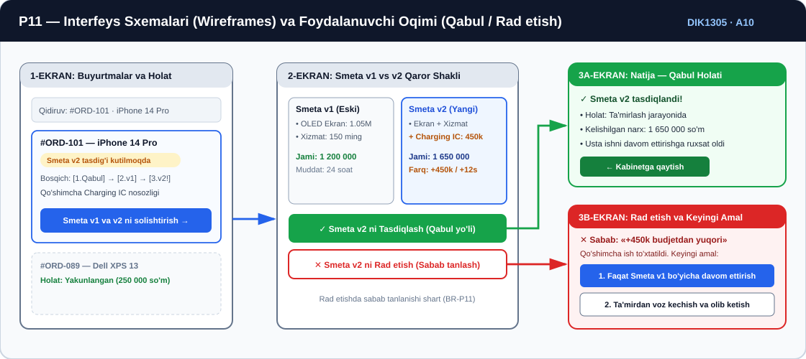
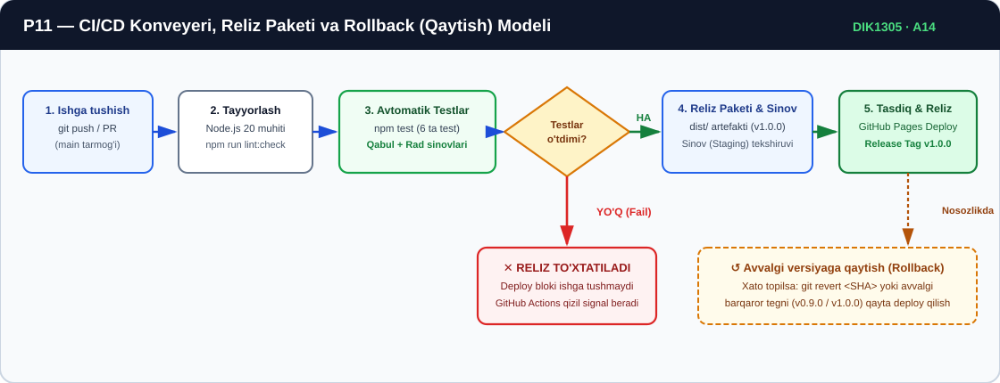

# 🛠️ TechFix Servis Kabineti (`P11`) — Telefon va noutbuk ta’mirlash servisining mijoz kabineti

[](https://github.com/dcoderbaza-bot/p11-servis-mijoz-kabineti/actions)


> **Universitet:** Cyber University · Dasturiy injiniringga kirish (`DIK1305`, 2026–2027 o‘quv yili)  
> **Talaba:** Temirov Dilshod Dilmurod o‘g‘li (`SWE25`)  
> **O‘qituvchi:** Katta o‘qituvchi Ergashev Muhammadsodiq  

---

## 🌐 Jonli Havolalar (100% Bepul Bulutli Infratuzilma)

| Muhit / Dalil | To‘g‘ridan-to‘g‘ri havola |
| :--- | :--- |
| **🚀 Ishlaydigan Yakuniy Mini-Ilova (Demo)** | **https://dcoderbaza-bot.github.io/p11-servis-mijoz-kabineti/** |
| **📐 Bosiladigan UI/UX Prototip Studiyasi (`A10`)** | **https://dcoderbaza-bot.github.io/p11-servis-mijoz-kabineti/prototype.html** |
| **🔀 Asosiy Biznes Qoidasi Merged PR (`#1`)** | **https://github.com/dcoderbaza-bot/p11-servis-mijoz-kabineti/pull/1** |
| **✨ Zamonaviy SaaS Dizayn va Demo Stend PRs (`#2`, `#3`)** | **https://github.com/dcoderbaza-bot/p11-servis-mijoz-kabineti/pulls?q=is%3Apr+is%3Aclosed** |
| **✅ GitHub Actions CI/CD Avtomatik Testlar** | **https://github.com/dcoderbaza-bot/p11-servis-mijoz-kabineti/actions** |
| **🏷️ Rasmiy Demo Versiya Relizlari (`v1.0.0` / `v1.1.0`)** | **https://github.com/dcoderbaza-bot/p11-servis-mijoz-kabineti/releases** |

---

## 📌 1. Muammo, Foydalanuvchi Oqimi va Asosiy Biznes Qoidasi (`A09`)

### Buyurtmachi muammosi
Qurilmasini (smartfon yoki noutbuk) servis markaziga topshirgan mijoz ta’mir narxi, tayyor bo‘lish muddati va joriy holatini bilish uchun servisga qayta-qayta qo‘ng‘iroq qiladi. Usta ichki diagnostikada qo‘shimcha nosozlik topsa, yangi xarajat bo‘yicha mijoz roziligini shaffof qayd etishi va kelishmovchilikning oldini olishi zarur.

### Foydalanuvchi oqimi (User Flow)
1. **Qabul xodimi** qurilma modeli, seriya/IMEI raqami va mijoz shikoyatini ro‘yxatga oladi (`#ORD-101`).
2. **Usta** birlamchi diagnostika bo‘yicha **Smeta v1** yaratadi; ichki nosozlik topilganda **Smeta v2** (`+Δ so'm`, `+Δ soat`) yuboradi.
3. **Mijoz** kabinetda `Smeta v1` va `Smeta v2` ni yonma-yon solishtirib **Tasdiqlaydi (Qabul)** yoki sabab ko‘rsatib **Rad etadi**.

### ⚖️ Asosiy Biznes Qoidasi (`BR-P11: Smeta versiyasi roziligi qoidasi`)
- **Qabul mezoni (`APPROVE`):** Mijoz eng so‘nggi amaldagi smetani (`Smeta v2 — 1 650 000 so'm`) tasdiqlasa, avvalgi `Smeta v1` arxivlanadi (`SUPERSEDED`), buyurtma `IN_PROGRESS` (*«Smeta tasdiqlandi — Ta’mirlash jarayonida»*) holatiga o‘tadi va ustaga ishlash ruxsati beriladi.
- **Rad etish mezoni (`REJECT` va `409 Conflict` Himoyasi):**
  1. Mijoz `Smeta v2` ni sabab tanlab rad etsa, qo‘shimcha xarajat darhol to‘xtatiladi (`ESTIMATE_REJECTED`) va mijozga keyingi aniq amallar taqdim etiladi: **`CONTINUE_V1`** (*faqat avval tasdiqlangan `1 200 000 so'm`lik `Smeta v1` doirasida davom ettirish*) yoki **`CANCEL_AND_PICKUP`** (*ta’mirdan voz kechib qurilmani olib ketish*).
  2. Usta mijoz tasdiqlamagan `Smeta v2` ustida ishni `IN_PROGRESS` yoki `COMPLETED` ga o‘tkazmoqchi bo‘lsa, modul amalni `409 Conflict` (`ERR_UNAPPROVED_ESTIMATE`) bilan rad etadi.
  3. Yangi `Smeta v2` mavjud bo‘lganda eskirgan `Smeta v1` ni qayta tasdiqlash urinishi `ERR_OUTDATED_VERSION` bilan rad etiladi.

---

## 🏗️ 2. Tizim Arxitekturasi va Interfeys Sxemalari (`docs/`)

### Komponentlar va ma’lumot oqimi diagrammasi (`A09`)


### Interfeys sxemalari va foydalanuvchi oqimi (`A10`)


### CI/CD konveyeri va avvalgi versiyaga qaytish (Rollback) modeli (`A14`)


---

## 🔌 3. REST API Backend Manzilari (`backend/server.js`)

| Metod | Manzil (Endpoint) | Vazifasi |
| :--- | :--- | :--- |
| `GET` | `/api/health` | Server va `P11` servisi ishchi holatini tekshirish |
| `GET` | `/api/orders?q=...` | Barcha buyurtmalar va smeta farqlarini (`v1` vs `v2`) olish / qidirish |
| `POST` | `/api/orders` | Qabul xodimi tomonidan yangi qurilmani ro‘yxatga olish |
| `POST` | `/api/orders/:id/estimates` | Usta tomonidan `Smeta v1` yoki `Smeta v2` yuborish |
| `POST` | `/api/orders/:id/decision` | Mijoz qarori (`APPROVE` yoki `REJECT` + sabab) — `BR-P11` tekshiruvi |
| `POST` | `/api/orders/:id/followup` | Rad etilgandan keyingi muqobil amalni (`CONTINUE_V1` / `CANCEL_AND_PICKUP`) qo‘llash |
| `POST` | `/api/orders/:id/status` | Ta’mir holatini yangilash (`IN_PROGRESS` / `COMPLETED` — tasdiqsiz bo‘lsa `409 Conflict`) |
| `POST` | `/api/reset` | Namoyish ma’lumotlarini dastlabki holatga qaytarish |

---

## 🚀 4. Lokal Ishga Tushirish va Avtomatlashtirilgan Testlar

Loyiha Node.js `v18+` standart kutubxonalarida yozilgan — qo‘shimcha pullik paketlar talab etilmaydi:

```bash
# 1. Repozitoriyni yuklab olish
git clone https://github.com/dcoderbaza-bot/p11-servis-mijoz-kabineti.git
cd p11-servis-mijoz-kabineti

# 2. Sintaksis va modullar butunligini tekshirish
npm run lint:check

# 3. Avtomatlashtirilgan testlarni ishga tushirish (Qabul va Rad etish — 6 ta test)
npm test

# 4. Lokal Full-Stack REST API + Veb-serverni ishga tushirish (http://localhost:3000)
npm start
```

> *Windows PowerShell eslatmasi:* ExecutionPolicy cheklovi bo‘lsa `npm.cmd test` va `npm.cmd start` (yoki `node --test tests/*.test.js` va `node backend/server.js`) buyrug‘ini ishlating.

---

## 🎬 5. 2–3 Daqiqalik Yakuniy Demo Yo‘riqnomasi (`A15`)

1. **Muammo va Smeta versiyalari (30 soniya):** [Jonli Demo](https://dcoderbaza-bot.github.io/p11-servis-mijoz-kabineti/) ochiladi. `#ORD-101 (iPhone 14 Pro)` buyurtmasida mijoz dastlabki ekran almashtirish smetasini (`Smeta v1: 1 200 000 so'm`) tasdiqlagan, usta esa Charging IC nosozligini topib `Smeta v2: 1 650 000 so'm (+450 000 so'm)` kiritgan.
2. **Qabul holati namoyishi (45 soniya):** Yuqoridagi `2. Qabul sinovi (Tasdiqlash)` yoki yashil `✓ Smeta v2 ni Tasdiqlash` tugmasi bosiladi — holat `Ta'mirlash jarayonida` ga o‘tadi va `📄 Elektron kvitansiya` ochiladi.
3. **Rad etish va himoya qoidasi namoyishi (45 soniya):** `3. Rad etish va keyingi amal` bosilganda `Smeta v2` sabab bilan rad etiladi va mijoz `Faqat Smeta v1 (1 200 000 so'm) bo'yicha davom ettirish` ni tanlaydi; `4. Usta 409 Himoyasi sinovi` bosilganda esa tasdiqlanmagan smeta ustida usta ishni yakunlay olmasligi ko‘rsatiladi.

---

## 🔄 6. Reliz va Avvalgi Versiyaga Qaytish (Rollback) Rejasi

- **Demo reliz versiyasi:** `v1.1.0` (`GitHub Releases` + `GitHub Pages` avtomatik CD).
- **Sifat darvozasi:** `.github/workflows/ci-cd.yml` ichida `deploy-release` bosqichi `needs: build-and-test` sharti bilan himoyalangan — kamida bitta avtomatik test xato bersa reliz to‘xtatiladi.
- **Rollback qadamlari:**
  ```bash
  git revert HEAD --no-edit
  git push origin main
  ```
  GitHub Actions 25 soniya ichida avvalgi barqaror reliz kodini qayta sinovdan o‘tkazib jonli GitHub Pages muhitiga tiklaydi.

---

## 🔍 7. Loyiha Retrospektivasi (`A15.5`)

1. **Nima yaxshi ishladi?**  
   Biznes qoidani yagona universal modulda (`src/domain/estimatePolicy.js`, commit `d75e8c1`) ajratib yozganimiz tufayli aynan bitta kod bazasi ham Node.js REST API serverida, ham statik GitHub Pages muhitida, ham `tests/*.test.js` avtomatik testlarida 100% bir xil natija berdi.
2. **Qanday qiyinchilik bo‘ldi?**  
   Mijoz ikkinchi smetani (`v2`) rad etganda dastlabki tasdiqlangan `Smeta v1` ma’lumotlari yo‘qolib ketmasligi kerak edi. Ushbu holatni [UI/UX Prototip 3B-ekrani](./prototype.html) va `TEST-02` ([PR #1](https://github.com/dcoderbaza-bot/p11-servis-mijoz-kabineti/pull/1)) orqali modellashtirib, `CONTINUE_V1` keyingi amal mexanizmi bilan yechdik.
3. **Keyingi versiyada (`v1.2.0`) nimani o‘zgartiramiz?**  
   Yangi smeta kiritilishi bilan mijozga Telegram Bot webhook bildirishnomasini yuborish hamda ko‘p filialli servis markazlari uchun bulutli PostgreSQL (Supabase) bazasini ulash rejalashtirilgan.
